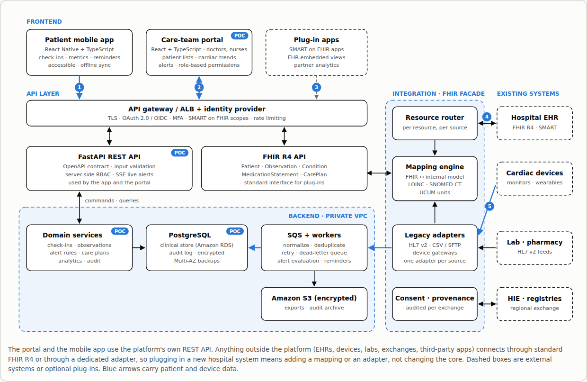

# Architecture

Diagrams (product ecosystem, application & FHIR integration layers with the five workflows, AWS deployment,
cardiac data pipeline, HIPAA essentials): open [docs/architecture.html](docs/architecture.html) in a browser.
Re-render the figure PNGs with `cd frontend && node e2e/shot-architecture.mjs`.



```
 device simulator ─┐                                   ┌─ REST (JSON) ──► React SPA (Vite build, nginx)
 ingest API ───────┼─► validation ─► PostgreSQL ─► analytics (pandas, cached) ─┤
 seed generator ───┘   + idempotency                    └─ SSE /api/stream ──► live queue refresh
```

## Components

| Layer | Tech | Notes |
|---|---|---|
| Frontend | React 18, TypeScript, Vite, Tailwind v4, Recharts, TanStack Query, React Router | shadcn-style primitives in `src/components/ui.tsx` (no generator step) |
| API | FastAPI, Pydantic v2 | routers `app/api.py` (clinical/ops) and `app/api_analytics.py`; OpenAPI at `/docs` |
| Persistence | PostgreSQL 16, SQLAlchemy 2, Alembic | all timestamps `timestamptz`, stored UTC; session timezone forced to UTC |
| Analytics | pandas / NumPy | `app/analytics.py`; frames loaded from SQL and cached (≤60 s, refreshed ≥3 s after any write) |
| Live updates | asyncio simulator + in-process event bus → Server-Sent Events | `app/simulator.py` |
| Auth | demo JWT (HS256) with role claims, server-side permission matrix | `app/auth.py` |

## Data model

`patients` (+ `monitoring_end`, `discharge_outcome`, device) · `diagnoses` (with `resolved_date`) ·
`medications` (start/end) · `treatments` (start/end) · `cardiac_measurements` (unique
`device_id + measurement_type + observed_at`) · `alarms` (unique `source_event_id`, ack/resolve times,
assigned nurse, review status, source, `simulated_flag`) · `clinical_reviews` · `audit_log`.

Diagnoses, medications and treatments keep their validity intervals so analytics attribute each alarm only to
the clinical context valid at the time it fired.

## Ingestion & data quality

- **Duplicates**: `INSERT … ON CONFLICT DO NOTHING` on the natural key; duplicates are counted, not stored.
- **Missing values**: stored with `numeric_value = NULL`, `quality_status = missing`; a whole-device dropout raises a *Signal loss* advisory alarm.
- **Delayed events**: `received_at − observed_at > 5 min` → `quality_status = delayed`; analytics always use `observed_at`.
- **Artifacts** (seed only): flagged `artifact` and excluded from vitals trend charts.

## Deployment path (AWS, not implemented)

ECS Fargate services for backend and frontend (or S3 + CloudFront for the static SPA) · RDS PostgreSQL
(Multi-AZ, encrypted, IAM auth) · Secrets Manager for `SECRET_KEY` / DB credentials · CloudWatch Logs + alarms ·
ALB with TLS · S3 for exports and audit-log archival. The SSE bus is in-process, so >1 backend replica would need
Redis pub/sub or Postgres `LISTEN/NOTIFY`, plus a leader-elected simulator.

## Known limitations (POC)

- Demo identity switcher instead of real authentication (no passwords, no SSO/MFA).
- Settings are in memory and reset on restart.
- Analytics recompute in-process with pandas; fine for ~10k alarms, would move to SQL materialised views at scale.
- No ECG waveform storage; fixed demo alarm thresholds instead of per-patient clinician-set limits.
- Single backend instance (in-process event bus and simulator).
