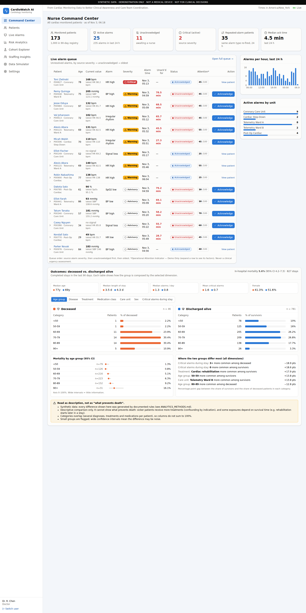

# CardioWatch AI

*From Cardiac Monitoring Data to Better Clinical Awareness and Care-Team Coordination.*

A full-stack proof of concept for cardiology care teams: a nurse command center with a live alarm queue,
patient drill-down, exposure-adjusted population alarm analytics, a cohort explorer, staffing insights,
a deceased-vs-survivor outcome comparison, and a live device simulator.

> **Synthetic data only. Not a medical device. Not HIPAA compliant.** All findings are descriptive associations
> from generated data with intentionally injected patterns (see [ANALYTICS_METHODS.md](ANALYTICS_METHODS.md)).
> Nothing here recommends treatment, infers medication causality or assigns clinical urgency.



**One platform, many health IoT products.** CardioWatch is the cardiology app and a reusable monitoring pipeline:
bedside, telemetry, ECG patch, cuffless BP monitor and biosensor ring are device profiles on the same pipeline, and a
new product is added as a profile plus an adapter ([docs/ADDING_A_DEVICE.md](docs/ADDING_A_DEVICE.md)).

- Architecture, integration, AWS, data pipeline, edge AI, regulatory map: [docs/architecture.html](docs/architecture.html)
- POC-to-market delivery pack (roadmap, backlog, risks, release gate, test evidence): [docs/delivery/](docs/delivery/README.md)

## Quick start (Docker — everything)

```bash
docker compose up --build
```

| What | URL |
|---|---|
| Web app | http://localhost:5180 |
| API | http://localhost:8010 |
| OpenAPI docs | http://localhost:8010/docs |
| Health | http://localhost:8010/health |

On first start the backend runs `alembic upgrade head` and seeds the synthetic dataset (≈30 s).
Pick a demo account on the login screen (no passwords — a demo identity switcher):

| Account | Role | Can |
|---|---|---|
| RN A. Moreau / RN G. Silva | nurse | view patients & alarms, acknowledge / review alarms, analytics |
| Dr. R. Chen | doctor | same as nurse + audit log |
| Admin | admin | simulator control, settings, audit log (no alarm handling) |

## Local development (without building images)

```bash
docker compose up -d db                       # PostgreSQL on 127.0.0.1:55440

cd backend
uv sync
uv run alembic upgrade head
uv run python -m app.seed --reset             # 1,000 patients, 90 days
uv run uvicorn app.main:app --port 8010 --reload

cd ../frontend
npm install
npm run dev                                   # http://localhost:5180 (proxies /api to :8010)
```

On WSL, if the Vite dev server stalls on first load, serve a build instead: `npm run build && npx vite preview --port 5180`.

## Tests

```bash
cd backend && uv run pytest                   # 33 tests: APIs, aggregation accuracy, exposure, duplicates, missing and
                                              # implausible data, RBAC, audit hash chain, devices, outbox, generator
cd frontend && npm test                       # 12 tests: rendering, filters, drill-down, loading/empty/error, charts, devices
cd frontend && npx playwright test acknowledge-workflow   # E2E (app must be running on :5180)
```

The backend suite uses a separate database `cardiowatch_test` (created by `scripts/init-test-db.sql`;
override with `TEST_DATABASE_URL`). CI runs both suites (`.github/workflows/ci.yml`).

**Screenshots** are reproducible: with the app running, `cd frontend && npm run screenshots` writes `docs/screenshots/*.png`.

## What's in the box

| Page | Highlights |
|---|---|
| Command Center | 6 KPIs, live alarm queue (severity → unacknowledged → oldest), alarms/hour, by-unit, **deceased vs. discharged-alive comparison** by age, disease, treatment, medication, unit, sex and critical-alarm burden, with mortality 95% CIs |
| Live Alarms | filter/sort, acknowledge, expandable *Operational Attention Indicator — Demo Only* factors, live SSE updates |
| Patients / Patient detail | registry search; demographics, vitals trends with demo limits, clinical timeline (diagnoses, medications, treatments), alarm timeline with acknowledge + review/resolve, review history |
| Risk Analytics | the 7 required charts (age, pathology, treatment, heatmap with timezone, age × pathology, medication × alarm type, trends); every chart has a table view |
| Cohort Explorer | combine 9 filter types, time-valid exposure, reference cohort, weekly trend, drill-down to patients |
| Staffing Insights | by shift, by hour, by unit with peak windows, live backlog, descriptive insight sentences |
| Devices & Integrations | device profiles (product templates with LOINC/UCUM signals and alarm rules), fleet health (offline, battery, firmware), integration outbox to the virtual-care platform |
| Data Simulator | configurable live device stream (abnormal / duplicate / delayed / signal-loss rates, falls, battery drain) |
| Settings | display timezone, repeat window, cohort-size thresholds, attention-indicator weights, injected-pattern notes, audit log |

## API

`GET /health` · `GET /api/dashboard/summary` · `GET /api/patients` · `GET /api/patients/{id}` ·
`GET /api/patients/{id}/measurements` · `GET /api/patients/{id}/alarms` · `GET /api/alarms` ·
`POST /api/alarms/{id}/acknowledge` · `POST /api/alarms/{id}/resolve` ·
`GET /api/analytics/{by-age,by-pathology,by-treatment,by-medication,age-pathology,hourly-heatmap,cohorts,trends,staffing,outcomes}` ·
`POST /api/simulator/{start,stop}` · `GET /api/simulator/status` · `GET /api/stream` (SSE) ·
`POST /api/ingest/measurements` · `GET/PUT /api/settings` · `GET /api/audit` · `POST /api/auth/login`.
Full schema at `/docs`.

## Repository layout

```
backend/   FastAPI app (app/), Alembic migrations, synthetic generator (app/seed.py), pytest suite
frontend/  React + TS + Vite + Tailwind + Recharts + TanStack Query; Vitest + Playwright
docs/      screenshots
```

See [ARCHITECTURE.md](ARCHITECTURE.md), [ANALYTICS_METHODS.md](ANALYTICS_METHODS.md), [SECURITY.md](SECURITY.md), [DEMO_SCRIPT.md](DEMO_SCRIPT.md).

## How this was built

Built with an AI coding assistant (Claude Code) from a written specification, as a working vertical slice first
(synthetic data → API → dashboard), then analytics, simulator, security controls and tests. Deliberate POC
simplifications are listed under *Known limitations* in [ARCHITECTURE.md](ARCHITECTURE.md).
The deceased-vs-survivor comparison was added on request; it is descriptive only, by design.
